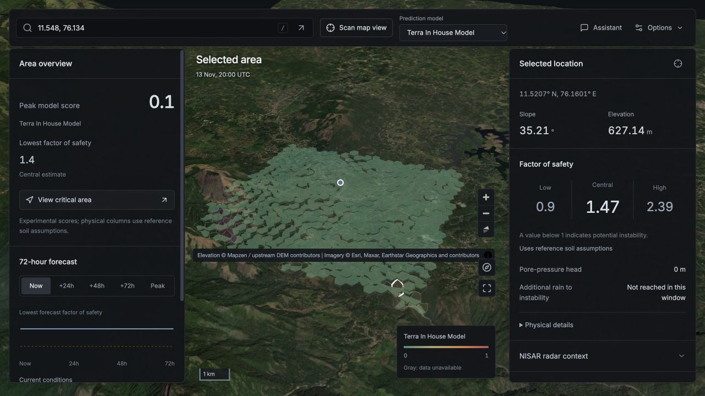
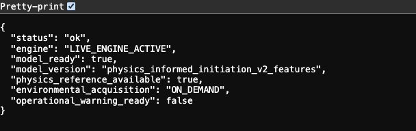
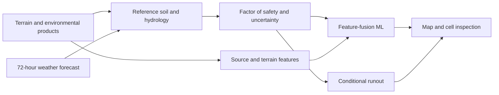

<div align="center">

# TERRA-SHIELD

**Explore terrain. Inspect the mechanics. Follow the forecast.**

Global landslide analysis with a 3D map, conditional physics, machine learning and automatic 72-hour weather forecasts.

[](https://github.com/pookie421/Terra/actions/workflows/ci.yml)
[](LICENSE)
[](docs/SETUP.md)

[Get started](#get-started) · [Setup & usage guide](docs/SETUP.md) · [How it works](#physics--ml) · [API](API_USAGE.md) · [Research evidence](docs/current_status.md)

</div>



<sub>Interface capture; values belong to that scan. Imagery © Esri, Maxar, Earthstar Geographics and contributors. Elevation © Mapzen / upstream DEM contributors.</sub>

## What is included

| Component | Included in a clone | What it does |
|---|---|---|
| Physics engine | Yes — [`backend/physics/`](backend/physics/) | Reference soil columns, infiltration response, factor of safety, uncertainty and conditional runout |
| Pretrained ML engine | Yes — [`artifacts/physics_informed_models.pkl`](artifacts/physics_informed_models.pkl), about 0.9 MB | Current feature-fusion model and its four model comparisons; runs on CPU |
| Web application & API | Yes — [`frontend/`](frontend/) and [`backend/api/`](backend/api/) | Global satellite terrain, coordinate scanning, forecasts, cell inspection and source provenance |
| NASA comparison & NISAR | Integration included; live coverage/subsets vary | Separately labeled NASA raster/reference scores and radar metadata or measured subsets |
| Assistant | Hosted API or optional local model | Ordered app controls and source-bound prose with the same evidence checks and explicit fallback status |

**You do not need to train a model, download the retained research corpus, or have a GPU to start the application.** The bundled ML artifact is an experimental research model, not a globally validated warning system. See its [model card and checksum](artifacts/MODEL_CARD.md).

## Get started

Use **Python 3.11 or 3.12**, **Node.js 22.12+**, and Git. Internet access is needed for map tiles and environmental providers. [Windows instructions and troubleshooting →](docs/SETUP.md)

**1. Start the backend** — macOS / Linux:

```sh
git clone https://github.com/pookie421/Terra.git
cd Terra
python3 -m venv .venv
source .venv/bin/activate
python -m pip install -r requirements.txt -c constraints-runtime.txt
python -m uvicorn backend.api.main:app --host 127.0.0.1 --port 8000
```

Leave this terminal running. The constraints select the compatible versions required by the bundled model snapshot.

**2. Start the frontend** — in another terminal, from the repository root:

```sh
cd frontend
npm ci
npm run dev
```

Open **[http://127.0.0.1:5173](http://127.0.0.1:5173)**. Vite forwards `/api` requests to the backend on port 8000. Keep both terminals running.

**3. Verify both engines** — open **[the health endpoint](http://127.0.0.1:8000/api/v1/health)**. It must report `physics_reference_available: true` and `model_ready: true`. This check does not fetch environmental feeds.



If the map opens but analysis cannot connect, follow the [connection checklist](docs/SETUP.md#troubleshooting). If you added or replaced model weights after starting the server, restart the backend.

## Use the workspace

1. **Choose an area.** Search for a place or `latitude, longitude`, click unscanned terrain, or use **Scan map view**. A place name is optional.
2. **Choose a model.** The main selector offers **Terra In House Model**, **NASA LHASA** and **Rainfall baseline**. Physics-only and weather/terrain comparisons remain advanced diagnostics. NASA rasters and unvalidated reference estimates remain visibly distinct. [Comparison and radar semantics](docs/nasa_radar_comparison.md).
3. **Inspect a location.** Click a returned hexagon. The inspector shows slope, the factor-of-safety envelope and pressure head; physical details, NISAR context and routing assumptions expand on demand.
4. **Explore the forecast.** Switch between **Now**, **+24h**, **+48h**, **+72h** and **Peak**. These update the in-house map and assessment from provider forecasts. Peak means the lowest forecast sector factor of safety. NASA's daily products do not supply a fabricated 72-hour forecast.
5. **Check the evidence.** **Options** groups map layers, Sources, Connections, export and diagnostics. Sources retains availability, retrieval times and fallback provenance. On smaller screens, use **Map**, **Overview** and **Inspect**.
6. **Ask or export.** The **Assistant** can navigate before the first scan and execute ordered model/horizon/layer/cell actions. Public action summaries and actual execution results are distinct. The deployment owner can configure a hosted assistant with `python scripts/configure_assistant.py`; visitors do not need personal keys. [Assistant connections and local alternatives](docs/assistant_connections.md). The [Windows trainer](docs/windows_5070ti.md) remains optional.

There are no manual weather sliders or fixed-city scan defaults. Provider failures and missing inputs remain visible; acceptance of a coordinate does not guarantee valid terrain or forcing everywhere.

## Physics & ML



The physical column combines effective-stress slope mechanics, antecedent water storage and a transient infiltration response. Published equation families are paired with explicitly labeled project material, depth and covariance priors. The result includes **`[FS_low, FS_mid, FS_high]`**, joint FOSM variance and sensitivities. Conditional Voellmy routing assumes release; it does not establish that a landslide will occur. [Equations, assumptions and limits →](docs/physics_sources.md)

The current **`physics_informed_initiation_v2_features`** model learns from source, terrain, mechanical and interaction features. Its learned trigger score and exposed mechanical-admissibility factor remain separate. The package includes **Rainfall-Only**, **Physics-Only**, **Weather+Terrain ML** and **Physics-Informed ML** comparisons. It does not use the retired per-row FOSM logit offset. [Architecture and evaluation →](docs/feature_fusion_phase3.md)

The NASA selector samples the public coarse raster; its exact served version and issue time are unverified by endpoint metadata. NISAR discovery is not deformation measurement, and the active classifier has no newly trained SAR weights. Optional documented site calibration can affect the physical column, while metadata-only radar leaves the broad reference calculation intact. Nominal 30 m DEM input and H3 cells averaging about 0.1 km² describe different spatial support; neither establishes forecasting superiority.

**Evidence, without inflated claims.** The target is a global system competitive with NASA LHASA 2.0. Current results do not establish parity or calibrated global failure probabilities. On the broader 510-row proxy benchmark, rainfall-only outperforms the coupled fusion model: AUC **0.7842 vs 0.6866**, Brier **0.1772 vs 0.2451**. [Full results, cohort limitations and missingness](docs/current_status.md) · [Source/API critique](docs/global_source_audit.md) · [Retired experiments](docs/research_history.md)

## Documentation & development

| Start here | Reference |
|---|---|
| Install, verify and use | [Setup guide](docs/SETUP.md) |
| API routes, state IDs and chat | [API reference](API_USAGE.md) |
| Physical assumptions | [Physics methods](docs/physics_sources.md) |
| NASA comparison and optional radar subsets | [NASA/NISAR guide](docs/nasa_radar_comparison.md) |
| Pretrained artifact and compatibility | [Model card](artifacts/MODEL_CARD.md) |
| Training and optional Windows/CUDA/QLoRA | [Training workflow](docs/training_workflow.md) · [RTX 5070 Ti guide](docs/windows_5070ti.md) |
| Contribute and validate | [Contributing](CONTRIBUTING.md) |
| Product and research direction | [Frontend specification](docs/FRONTEND_SPEC.md) · [Roadmap](ROADMAP.md) |

Canonical source lives in `backend/`, `frontend/` and `scripts/`. Portable `training/` and Windows bundles are generated locally; duplicate copies, raw corpora, provider caches, historical weights and local agent notes are not published. The small, approved runtime model is the explicit exception. Reproducing the retained training results requires the documented source corpus; starting the app does not.

```sh
python -m unittest discover -s tests -v
```

For frontend validation, run `npm test`, `npm run build` and `npx tsc --noEmit` from `frontend/`. Some retained-corpus regressions skip when their local inputs are absent. Installation checks, predictive skill and operational readiness are separate claims.

Original code and documentation are [MIT licensed](LICENSE). The model's provenance, source acknowledgements and serialization limits are in its [model card](artifacts/MODEL_CARD.md); upstream products and optional Qwen weights retain their own terms. [Third-party notices](THIRD_PARTY_NOTICES.md).
