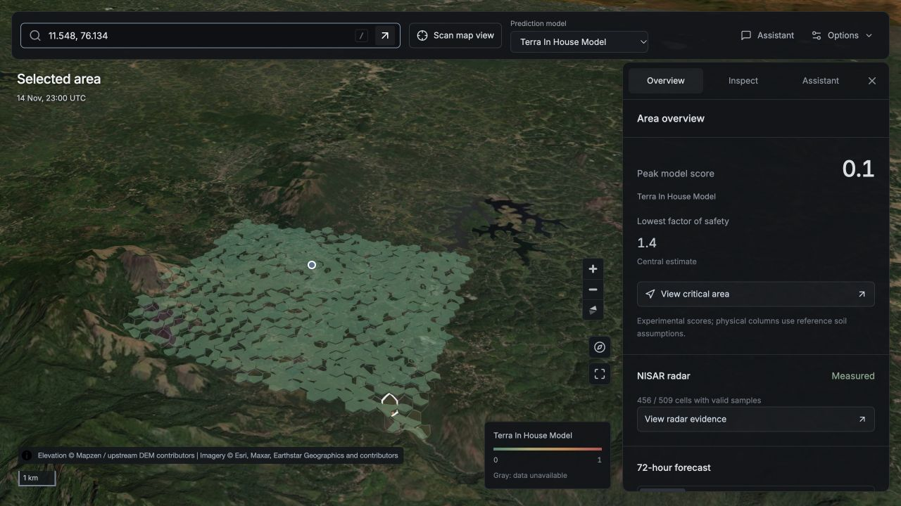
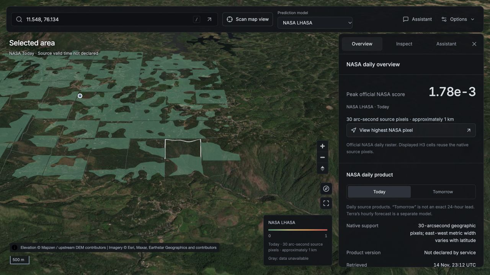
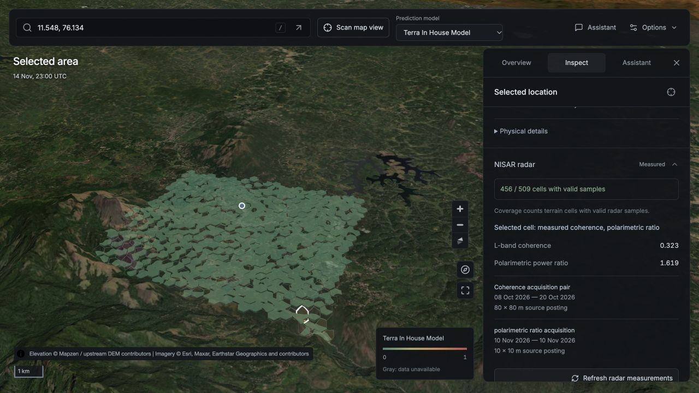
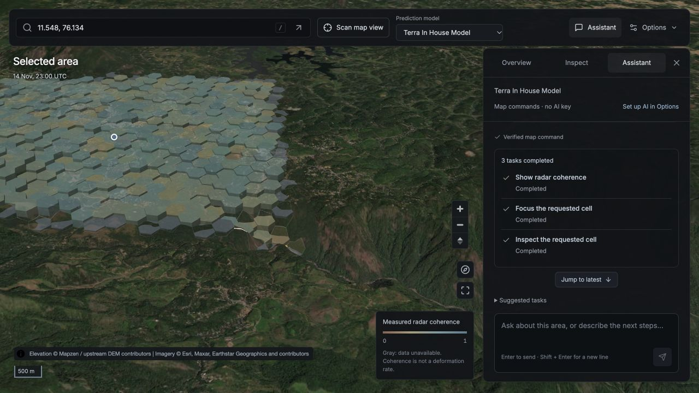
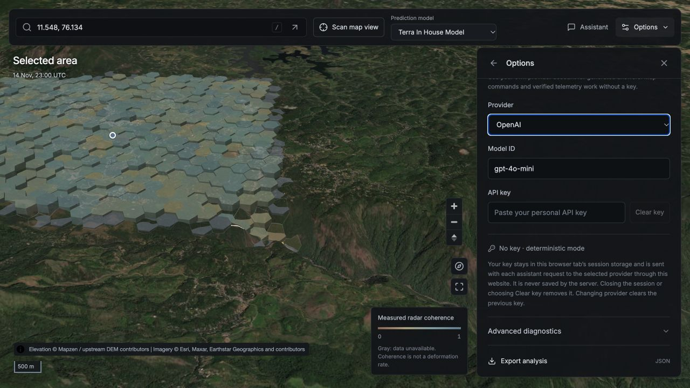

<div align="center">

# TERRA-SHIELD

### A clearer view of landslide hazard

Explore mountains, valleys and surrounding terrain, compare landslide models, and inspect the evidence behind an estimate.

**[Open the live website →](https://terra-production-289057fe.up.railway.app/)**

[Your first scan](#your-first-scan) · [User guide](docs/USER_GUIDE.md) · [Research & sources](docs/RESEARCH_AND_SOURCES.md) · [Run locally](docs/SETUP.md)

[](https://github.com/pookie421/Terra/actions/workflows/ci.yml)
[](https://github.com/pookie421/Terra/actions/workflows/container.yml)
[](LICENSE)

</div>

[](https://terra-production-289057fe.up.railway.app/)

*A captured analysis in the map workspace. Values, source coverage and dates belong to that scan and will vary. Imagery © Esri, Maxar, Earthstar Geographics and contributors. Elevation © Mapzen / upstream DEM contributors.*

## Your first scan

You can use the public website without installing software. Environmental analysis and supported assistant map commands work without an AI API key.

1. **Find an area.** Search a place name, enter `latitude, longitude`, select unscanned terrain on the map, or choose **Scan map view**. A named location is optional.
2. **Review the overview.** See the selected model's peak score, current conditions and applicable forecast. **View critical area** focuses the model's hotspot.
3. **Inspect the terrain.** Select a returned hexagon and open **Inspect** for slope, factor-of-safety estimates, radar evidence and conditional runout.
4. **Compare approaches.** Change the prediction model in the toolbar. NASA's daily products and Terra's hourly forecast retain their own controls and interpretation.
5. **Check the evidence.** Open **Options → Sources** for availability and provenance. Use **Export analysis** to keep the current structured result.

The [illustrated user guide](docs/USER_GUIDE.md) explains each control, the meaning of the numbers and how to recover from common errors.

## Two prediction engines, plus a baseline

| Choice | What it provides | Time and spatial context |
|---|---|---|
| **Terra In House Model** | Live environmental inputs, reference slope physics and trained machine learning; inspectable physical columns, uncertainty envelopes and conditional runout. | Current conditions and automatic projections through 72 hours when forcing is available. H3 terrain cells share inputs with different native supports. |
| **NASA LHASA** | An independent view of NASA's official landslide raster products, with native pixels and source information. | **Today / Tomorrow** daily products, approximately 30 arc-second source pixels. Tomorrow is not an exact T+24h product. |
| **Rainfall baseline** | A simpler learned comparison that helps explain what the additional model components contribute. | A diagnostic comparison; its score is not interchangeable with NASA output or a factor of safety. |

Physics-only and weather/terrain components remain under **Options → Advanced diagnostics**. [How NASA comparison and radar evidence work →](docs/nasa_radar_comparison.md)

[](docs/images/nasa-daily-products.jpg)

*NASA keeps its own daily-product controls and native pixel support. Terra's hourly forecasts and physical column are available through the in-house view.*

## A map you can investigate

| View or control | Use it to… |
|---|---|
| **Overview** | Understand the scanned area, see the active model and choose its available time product. |
| **Inspect** | Examine one terrain cell, its physical assumptions, uncertainty, measured radar samples and potential runout. |
| **Assistant** | Ask about the active evidence or describe a sequence of map tasks; follow actual execution results. |
| **Options** | Change map layers, inspect Sources, configure your personal AI key, open diagnostics or export JSON. |
| **Map** on mobile | Return to an unobstructed map while keeping the analysis available in the other tabs. |

Results and the conversation are tied to the active scan, state, cell and prediction model. The interface keeps technical identifiers and detailed source records in expandable sections.

## Look inside the workspace

| Inspect physical and radar evidence | Follow assistant tasks |
|---|---|
| [](docs/images/cell-radar-evidence.jpg) | [](docs/images/assistant-tasks.jpg) |
| Review the reference factor-of-safety column, valid radar samples, acquisition dates and native source posting. A sector can have measurements while one selected cell is masked. | See which actions are planned, running, completed or failed. Evidence notes and numeric citations expand separately from the response. |

[](docs/images/assistant-options.jpg)

*AI settings live inside Options. A personal key enables generated explanations; it is not required to compute the physical or ML analysis. Screenshots show captured interface states, not global validation results.*

## What the main numbers mean

| Readout | How to read it |
|---|---|
| **Model score** | An experimental model output used to compare cells within its supported context. It is not an established globally calibrated failure probability. |
| **Factor of safety: Low / Central / High** | A conditional mechanical estimate and uncertainty envelope. A value below 1 indicates potential instability under the supplied column; reference material and water-state assumptions remain part of the result. |
| **Pressure head / additional rain to instability** | Hydrologic and threshold-model estimates, with units and applicability. They are not direct groundwater measurements. |
| **NISAR coverage and samples** | Genuine raster observations where available, with acquisition and pixel support. Coherence is not a motion rate, and an HV/HH power ratio is not calibrated soil moisture. |
| **Potential runout** | Conditional paths if material is released under the displayed rheology/depth assumptions. Paths can stop at the scan boundary. |
| **Gray or unavailable** | Missing or unsupported evidence, rather than a numerical zero or a statement that the terrain is safe. |

NISAR measurements are included in the evidence context. The active classifier has not been retrained with SAR features; no generic coherence-to-soil-strength conversion is applied. [Interpretation guide →](docs/USER_GUIDE.md#read-the-physical-column)

## Use your preferred AI provider

1. Open **Options → AI Model & API Key**, or choose **Set up AI in Options** in the Assistant.
2. Select OpenAI, Google Gemini, Anthropic Claude, Groq, OpenRouter or a public HTTPS OpenAI-compatible endpoint.
3. Enter a model ID available in your account and paste your personal key into the masked field. Settings update automatically for the browser session.
4. Return to chat with the back arrow. **Clear key** removes the active credential.

The website does not fund generated assistant requests through a shared server key. Your selected provider receives the message and active analysis context; the server checks numeric bindings and authorized actions before accepting generated prose. **Key configured** and a successfully verified provider response are distinct states. Without a key, deterministic verified telemetry and supported map commands remain available.

[Assistant setup, privacy and custom endpoints →](docs/assistant_connections.md)

## Run the engine locally

The physics implementation and approved small pretrained ML artifact are included. A GPU, Ollama, a language-model download or a training run is unnecessary for the website.

Use **Python 3.11 or 3.12** and **Node.js 22.12+**. On macOS/Linux, the basic setup is:

```sh
git clone https://github.com/pookie421/Terra.git
cd Terra
python3.11 -m venv .venv
source .venv/bin/activate
python -m pip install -r requirements.txt -c constraints-runtime.txt
python -m uvicorn backend.api.main:app --host 127.0.0.1 --port 8000
```

Open a second terminal in the same `Terra` repository:

```sh
cd frontend
npm ci
npm run dev
```

Open the URL printed by Vite, normally **http://127.0.0.1:5173**. Keep both terminals running. [The setup guide](docs/SETUP.md) includes Windows commands, native-library prerequisites, model verification and troubleshooting.

The bundled model is [`artifacts/physics_informed_models.pkl`](artifacts/physics_informed_models.pkl), documented by its [model card](artifacts/MODEL_CARD.md) and [checksum manifest](artifacts/runtime_manifest.json). The frontend alone cannot run the Python engine. Full research reproduction needs separately provisioned corpora; running the included artifact does not require them.

## Understand the research

The [research and sources guide](docs/RESEARCH_AND_SOURCES.md) connects the papers, implemented equations, model architecture, input products and validation evidence. It distinguishes observations, upstream model products, project-derived proxies and reference priors, rather than treating every authentic API value as a local measurement.

| Question | Read |
|---|---|
| How are stability, infiltration, uncertainty and runout calculated? | [Physical methods and sources](docs/physics_sources.md) |
| How do the learned model, mechanical coupling and ablations work? | [Feature-fusion architecture and evaluation](docs/feature_fusion_phase3.md) |
| Where do the weather, terrain, soil, satellite and event numbers come from? | [Research and sources](docs/RESEARCH_AND_SOURCES.md) · [Global source audit](docs/global_source_audit.md) |
| What is implemented, and what still needs evidence? | [Current status](docs/current_status.md) · [Roadmap](ROADMAP.md) |
| Which earlier approaches did not work? | [Research history](docs/research_history.md) |

Outputs are conditional research estimates for visualization and analysis, not operational warnings. Independent global predictive skill and parity with LHASA have not been established. The broader retained proxy experiment currently favors rainfall-only over the coupled model; the [full results](docs/feature_fusion_phase3.md) retain that finding and the unsuccessful experiments.

## Find the right guide

| I want to… | Start here |
|---|---|
| Use the public website | [Illustrated user guide](docs/USER_GUIDE.md) |
| Install and troubleshoot my own copy | [Local setup](docs/SETUP.md) |
| Read papers and understand source quality | [Research and sources](docs/RESEARCH_AND_SOURCES.md) |
| Host a website or connect a custom domain | [Railway and Docker deployment](docs/deployment.md) |
| Integrate scans or chat into another tool | [API reference](API_USAGE.md) |
| Reproduce or extend the hazard-model research | [Research workflow](docs/training_workflow.md) · [Model card](artifacts/MODEL_CARD.md) |
| Contribute fixes or documentation | [Development guide](CONTRIBUTING.md) |

<details>
<summary><strong>Repository layout</strong></summary>

```text
backend/     Physics, ML, provider ingestion, scan API and assistant verification
frontend/    Satellite/terrain workspace, inspection and assistant interface
artifacts/   Approved runtime model, model card and compatibility manifest
docs/        User guides, methods, research, source audits and deployment notes
scripts/     Checks, research/rebuild tools and local utilities
tests/       Deterministic engineering, provider and model contracts
```

Raw corpora, provider archives, private notes, credentials and generated research bundles stay outside Git. The runtime model is the explicitly approved published artifact.

</details>

The public preview uses Railway hosting; availability depends on its hosting resources and upstream services. [Troubleshoot busy or expired scans →](docs/USER_GUIDE.md#when-something-does-not-work)

Original project code is [MIT licensed](LICENSE). Imagery, observations, inventories, model assets and third-party software retain their own terms and acknowledgements: [third-party notices](THIRD_PARTY_NOTICES.md).

---

<sub>A project by <strong>Team Orangeo</strong> for the <strong>2026 NASA Space Apps competition</strong>.</sub>
