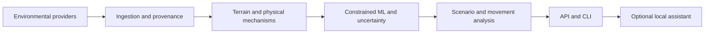

# TERRA-EXPERIMENTAL
**This is an experimental branch, serious stuff doesnt go here**

### Multi-hazard terrain analysis, with traceable evidence

TERRA-SHIELD is a research platform for exploring landslide susceptibility and the processes that can destabilize a slope. It combines environmental data, terrain analysis, slope mechanics and machine learning in a shared API and interactive command-line interface.

The aim is a global terrain workbench: locate a slope, inspect the evidence, compare triggering scenarios and understand potential movement and exposure. An interactive map interface and independently validated decision-support workflows are planned.

**Research status:** the backend and CLI are implemented. Scores, movement estimates and 72-hour projections are experimental; they are not operational warnings or validated failure probabilities.

[Quick start](#quick-start) · [API guide](API_USAGE.md) · [Evaluation](docs/current_status.md) · [Scientific methods](docs/physics_sources.md) · [Roadmap](ROADMAP.md)

## Capabilities

- **Terrain analysis:** H3 cells, elevation, slope, curvature, wetness indices and downslope connectivity.
- **Five causal regimes:** rainfall, earthquakes, snowmelt and thaw, post-fire runoff, and anthropogenic or fluvial disturbance.
- **Physics and machine learning:** mechanical Factor of Safety, pore-pressure response, constrained XGBoost, grouped calibration and uncertainty diagnostics.
- **Scenario comparison:** rainfall, shaking, warming and burn perturbations, plus hourly projections over a 72-hour horizon.
- **Provisional movement analysis:** kinematic branches, runout paths and intersections with mapped exposure.
- **Evidence inspection:** provider timestamps, live/cache/fallback status, input assumptions and grouped feature attribution.
- **Optional local assistant:** Qwen-backed tool use with numeric consistency checks and a deterministic fallback.

## Quick start

Python 3.11 or 3.12 is recommended for the documented workflow.

```bash
git clone https://github.com/pookie421/Terra.git
cd Terra
python -m venv .venv
source .venv/bin/activate
# Windows PowerShell: .venv\Scripts\Activate.ps1
python -m pip install -r requirements.txt
python scripts/terra_cli.py
```

The CLI provides guided location entry, examples, scenario controls, source details and terminal charts.

```bash
# Search by place name
python scripts/terra_cli.py "Zermatt, Switzerland" --non-interactive

# Explicit coordinates: latitude first, longitude second
python scripts/terra_cli.py --lat 11.548 --lon 76.134 --non-interactive

# Labels allow either order; hemisphere notation is also supported
python scripts/terra_cli.py "longitude=76.134 latitude=11.548"
python scripts/terra_cli.py "42.26 S, 173.62 E"

# Input help and full source telemetry
python scripts/terra_cli.py --examples
python scripts/terra_cli.py "Zermatt, Switzerland" --details --plain
```

At the location prompt, choose **2** to enter latitude and longitude separately or **?** for examples. Unlabeled coordinate pairs always mean **latitude, longitude**. South and west use negative values or hemisphere suffixes.

Scans fetch fresh data by default. `--use-cache` permits unexpired memory-cache reads; a failed live request may also use a disclosed memory fallback. Place-name lookups query the live geocoder before any known-coordinate fallback.

**Datasets and trained weights are not included.** Without a trusted XGBoost artifact, the service discloses physics-only scoring. Public-provider access requires a network connection. Ollama is optional.

## API

```bash
python -m uvicorn backend.api.main:app --host 127.0.0.1 --port 8000
```

Open `http://127.0.0.1:8000/docs` for the interactive schema.

```bash
curl 'http://127.0.0.1:8000/api/v1/scan?query=Wayanad&lat=11.548&lon=76.134&rain_delta_mm=180'
```

The API returns terrain GeoJSON, scenario summaries, hotspot and runout estimates, source provenance and forecast availability. Missing terrain is reported as `UNAVAILABLE`. See the [API guide](API_USAGE.md) for agent requests, forecast injection and output semantics.

## Architecture



| Input | Providers | Interpretation |
|---|---|---|
| Terrain | Terrarium elevation tiles | Sampled elevation and derived terrain features |
| Weather and moisture | Open-Meteo, NASA POWER | Model-derived and coarse environmental estimates |
| Landslide and event context | NASA COOLR, NASA EONET | Mixed inventory geometries and reported events |
| Earthquakes | USGS | Catalog events; site shaking uses a project proxy |
| Soil and geology | SoilGrids, Macrostrat | Mapped properties and disclosed fallback assumptions |
| River flow | Open-Meteo GloFAS | Modeled discharge |
| Imagery and exposure | Esri imagery, OpenStreetMap | Optical proxies and incomplete mapped assets |

Provider availability does not establish local measurement accuracy. NASA data use is attributed in telemetry; the project is independently developed and is not endorsed by NASA.

## Evaluation and limitations

The reference CPU evaluation recorded spatial cross-validation ROC-AUC **0.8429**, event-holdout ROC-AUC **0.6979**, and Recall@40 **0.875** on a **48-row holdout**. Recall@40 selects most of that small sample. Cross-validation evaluates the raw booster; holdout evaluation uses calibrated event-buffer scores. Neither establishes calibration of the final live physics/ML blend.

The deterministic suite contains 64 tests. The latest scenario evaluation has both successes and failures, including stable-ground false alarms and missed instability thresholds. Forecast skill, global generalization, uncertainty coverage and runout accuracy remain unvalidated. The holdout has been used during development; an untouched external evaluation is needed.

See [evaluation results](docs/current_status.md) for measured outcomes and [scientific methods](docs/physics_sources.md) for equation provenance, proxy inputs and known limitations.

## Training and development

```bash
# Acquire source observations and construct training partitions
python backend/ml/build_real_labeled_dataset.py --output data/real_global_landslide_observations.parquet --max-events 450

# Fit the CPU baseline and generate evaluation reports
python scripts/train_baseline.py --skip-dataset-build --provider-timeout 15

# Run deterministic tests
python -m unittest discover -s tests -v
```

The [training guide](training/README.md) covers the optional CUDA XGBoost and QLoRA workflows. Generated datasets, weights, provider snapshots and evaluation logs stay outside version control. Training scripts preserve event/spatial isolation and distinguish simulated controls from observational records.

Contributions should include reproducible examples and validation appropriate to the change. Scientific changes should identify their source, assumptions and applicability. See [CONTRIBUTING.md](CONTRIBUTING.md) and the [roadmap](ROADMAP.md).

## License and data terms

Original project code is available under the [MIT License](LICENSE). Datasets, imagery and base models retain their respective licenses and access conditions; see [THIRD_PARTY_NOTICES.md](THIRD_PARTY_NOTICES.md).
