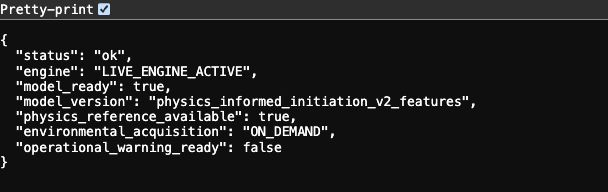
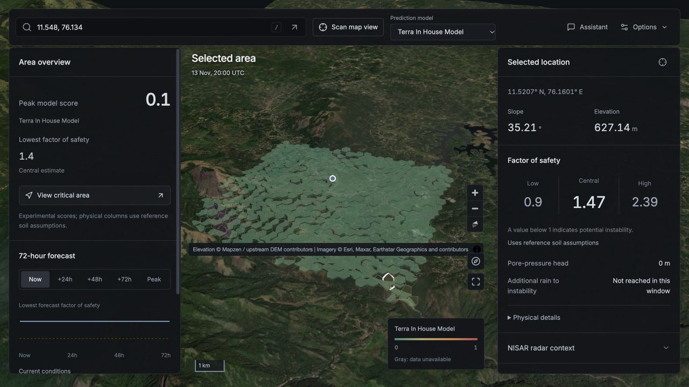

# Set up and use TERRA-SHIELD

[Back to the project](../README.md) · [API reference](../API_USAGE.md) · [Model card](../artifacts/MODEL_CARD.md)

The browser and analysis service run as two local processes. The physics implementation and the small pretrained four-model ML artifact are included in this repository. You do **not** need the retained training corpus, a GPU, or Ollama to start the map and analysis engines.

## Before you start

Install **Python 3.11 or 3.12**, **Node.js 22.12+**, npm, and Git. Allow Internet access for satellite imagery, terrain, weather, and other providers. Provider availability and coverage vary; a working local engine does not guarantee every upstream source responds.

XGBoost also needs its platform runtime libraries: Windows uses the [Microsoft Visual C++ Redistributable](https://xgboost.readthedocs.io/en/stable/install.html); if macOS reports a missing `libomp.dylib`, run `brew install libomp` using Homebrew before restarting Python. These are native-library prerequisites, separate from the model file.

Run commands from the repository root unless a step says otherwise.

## 1. Clone the complete repository

```sh
git clone https://github.com/pookie421/Terra.git
cd Terra
```

The active ML artifact must be present at `artifacts/physics_informed_models.pkl`. Copying only `frontend/` or installing Python dependencies alone does not provide the backend and its model.

## 2. Create a Python environment

**macOS / Linux** — use your installed 3.11 or 3.12 executable:

```sh
python3.11 -m venv .venv
source .venv/bin/activate
```

**Windows PowerShell:**

```powershell
py -3.11 -m venv .venv
.\.venv\Scripts\Activate.ps1
```

If PowerShell blocks activation, invoke `.\.venv\Scripts\python.exe` in place of `python` below; changing the execution policy is unnecessary.

Install the runtime dependencies with the model-compatible constraints:

```sh
python -m pip install -r requirements.txt -c constraints-runtime.txt
```

The constraints keep the included serialized ML artifact on its declared numerical-library versions. Do not substitute an arbitrary XGBoost version and assume pickle compatibility. See the [model card](../artifacts/MODEL_CARD.md).

## 3. Start and verify the analysis service

Keep this terminal open:

```sh
python -m uvicorn backend.api.main:app --host 127.0.0.1 --port 8000
```

Open [the engine health endpoint](http://127.0.0.1:8000/api/v1/health). It should report `status: "ok"`, `physics_reference_available: true`, and `model_ready: true`.



*The health check verifies local service/model availability without acquiring environmental providers. It does not certify predictive skill or provider coverage.*

The [interactive API documentation](http://127.0.0.1:8000/docs) is available on the same service. Restart the backend after replacing or restoring weights: model loading occurs when the service starts.

## 4. Start the browser application

Open a **second terminal**. From the cloned `Terra` directory:

```sh
cd frontend
npm ci
npm run dev
```

Open the local URL printed by Vite, normally [http://127.0.0.1:5173](http://127.0.0.1:5173). Keep both terminals running. Vite forwards `/api` requests to `http://127.0.0.1:8000`; the browser does not run the Python engine itself.

## 5. Scan and inspect an area



*Interface capture; values belong to that scan. Imagery © Esri, Maxar, Earthstar Geographics and contributors. Elevation © Mapzen / upstream DEM contributors.*

1. **Choose a location.** Search a place name, enter `latitude, longitude`, click an unscanned point on the map, or choose **Scan map view**. A place name is optional; unnamed terrain works through coordinates.
2. **Review the area overview.** The peak initiation score and lowest central factor of safety summarize the returned area. **View critical area** focuses the selected hotspot.
3. **Inspect a cell.** Click a returned hexagon. The selected location shows slope, elevation, the low/central/high factor-of-safety estimates, pressure head, and rain deficit. Expand **Physical details** for provenance, variance sensitivities, and model internals.
4. **Change the displayed time.** Choose **Now**, **+24h**, **+48h**, **+72h**, or **Peak**. Available future states use the downloaded forecast; **Peak** is the minimum sector nominal factor of safety, not a predicted failure time.
5. **Change the map layer.** Switch between initiation score, factor of safety, slope, and pressure head. Gray means unavailable evidence, rather than zero hazard.
6. **Check supporting evidence.** Open **Sources** for availability, fallbacks, timing, and errors. Expand **Model comparison** for the four ablations and **Potential runout** for conditional routing assumptions.
7. **Ask the Assistant.** Questions use the active scan, forecast state, and selected cell. Open response details to inspect verification and numeric citations. The download button exports the current analysis.

On smaller screens, use **Map**, **Overview**, and **Inspect** at the bottom to switch panels. Weather inputs remain automatic and read-only; there are no manual weather sliders or preset replay locations.

Reference soil assumptions keep conditional physics available without boreholes. Experimental scores, factor-of-safety envelopes, and hypothetical runout are not calibrated global failure probabilities or operational warnings. [Current evidence and limitations](./current_status.md) explain their interpretation.

## Optional: use a local Qwen assistant

The physics and ML engines work independently of the language model. To enable generated assistant prose, install and start [Ollama](https://docs.ollama.com/quickstart), then download a compatible local model, for example:

```sh
ollama pull qwen2.5:1.5b
ollama list
```

Use `qwen2.5:7b` instead if appropriate for your hardware. The [official model listing](https://ollama.com/library/qwen2.5:1.5b) documents the model and its license. On systems without a running Ollama service, start it with `ollama serve` in another terminal. TERRA-SHIELD connects to `http://localhost:11434` and prefers a local `terra-shield-qwen` model, then another installed Qwen2.5 model.

Custom fine-tuned Qwen weights are **not** included. An unreachable Ollama service produces an explicitly verified template fallback (`VERIFIED_TEMPLATE`). A reachable service without a compatible model produces `MODEL_UNAVAILABLE`. Generated prose must still pass grounding checks; installing a base model does not guarantee every response is accepted.

For a trained adapter, use the native [RTX 5070 Ti training and serving guide](windows_5070ti.md). It includes a direct Ollama-compatible server and an optional GGUF export helper. Set `TERRA_QWEN_URL` in the backend environment to change the local model-service address.

## Troubleshooting

| Symptom | Check |
|---|---|
| **Service unavailable** or `/api/v1/health` will not open | Start Uvicorn from the repository root, keep its terminal open, and check that port 8000 is available. Starting only Vite is insufficient. |
| `model_ready: false` | Check the exact artifact path, use the constrained dependency installation above, inspect backend startup errors, and restart the backend. Restore the published artifact rather than trying to train without the retained corpus. |
| Model load fails after upgrading packages | Recreate the virtual environment using `constraints-runtime.txt`; the included pickle is not a cross-version model interchange format. |
| Map is blank or source tiles fail | Check browser WebGL support and access to the imagery/elevation providers. Local backend health alone does not test online map tiles. |
| Scan has missing inputs or no learned score | Open **Sources** and the returned reason. ML requires a complete weather window and compatible metric terrain. A provider outage is distinct from a missing model. |
| Future buttons are unavailable | Inspect forecast coverage and the returned reason. Current conditions remain separate from missing future forcing. |
| Assistant uses fallback or reports model unavailable | Check Ollama is running on port 11434 and `ollama list` contains Qwen2.5. This does not block the physical or ML scan engines. |

For model retraining or the Windows/CUDA workflow, follow [Training](./training_workflow.md). It requires separately provisioned source-reviewed corpora; the runtime model alone cannot reconstruct that dataset. Generated `training/` and `windows_5070ti_trainer/` directories stay local. After provisioning the retained inputs, `python scripts/sync_training_bundle.py` generates the portable bundles from canonical root source.
