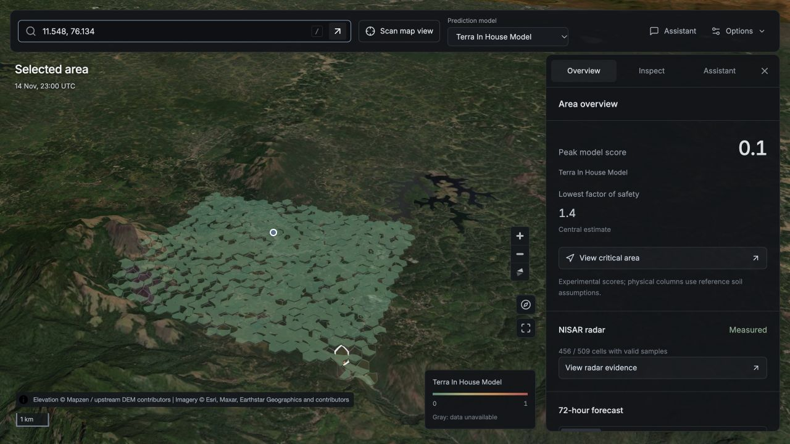
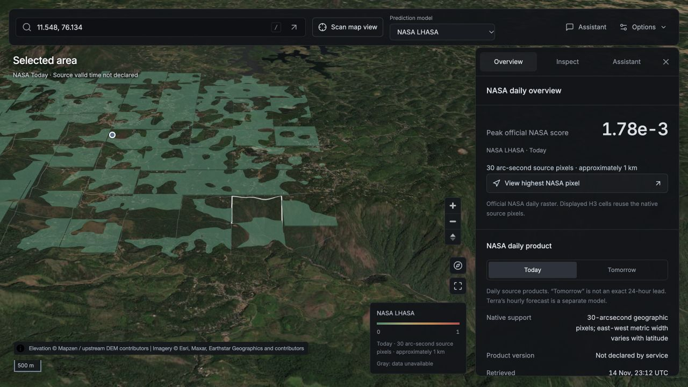
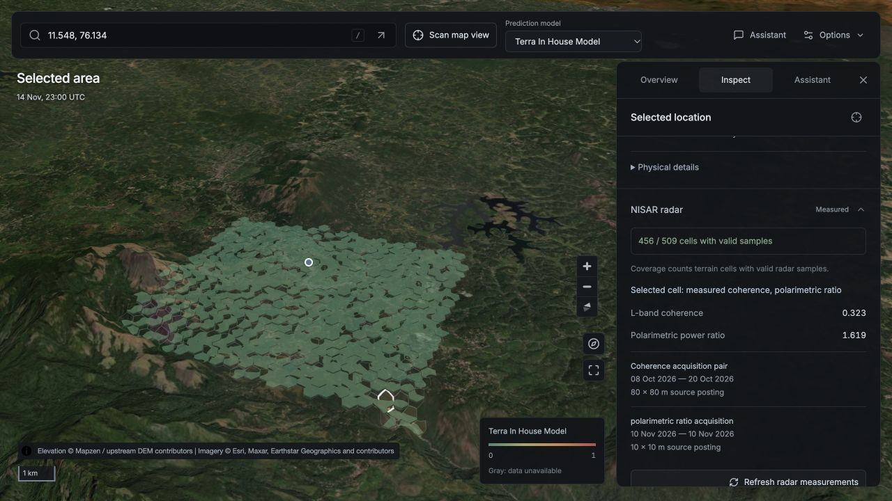
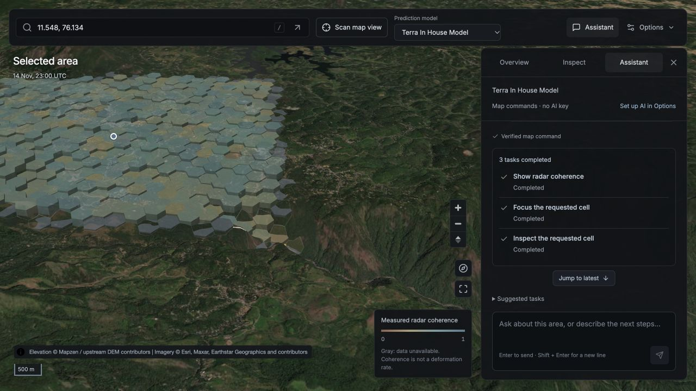
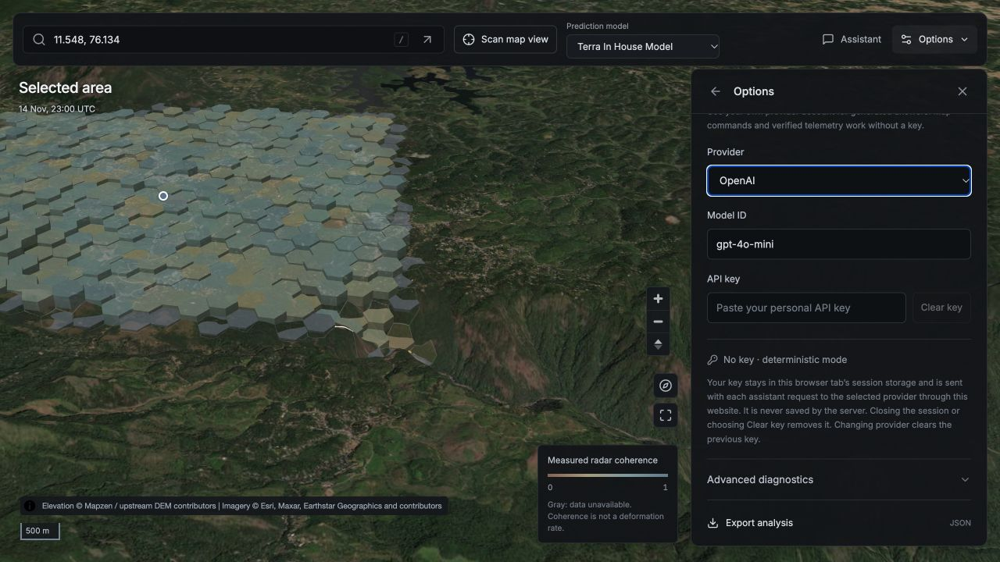

# Use the map and understand a result

[Open the website](https://terra-production-289057fe.up.railway.app/) · [Project home](../README.md) · [Install locally](SETUP.md) · [Research and sources](RESEARCH_AND_SOURCES.md)

TERRA-SHIELD is a workspace for exploring landslide-related terrain, environmental conditions and conditional model estimates. Start with a location, inspect the returned evidence, then compare models or forecast states. You do not need an AI API key to run an analysis.

**In this guide:** [Find an area](#find-an-area) · [Read the overview](#read-the-overview) · [Choose a model](#choose-a-prediction-model) · [Inspect a cell](#read-the-physical-column) · [NISAR](#check-nisar-radar-evidence) · [Runout](#explore-potential-runout) · [Assistant](#work-with-the-assistant) · [API keys](#add-your-own-ai-key) · [Export](#keep-and-share-a-result) · [Troubleshooting](#when-something-does-not-work)

## Find an area

Use whichever route fits your task:

| Starting point | What to do |
|---|---|
| A place name | Enter it in the search field and choose the search arrow. Place lookup resolves the name before acquisition. |
| Coordinates | Enter decimal `latitude, longitude`, in that order. For example, `11.548, 76.134` demonstrates the accepted syntax. |
| Unnamed terrain | Pan and zoom to the area, then select terrain outside the existing result grid. A place name is unnecessary. |
| The visible map area | Choose **Scan map view**. The scan uses the visible map area's center, accounting for the workspace dock. |
| An existing result | Select one of its hexagons to inspect that cell instead of starting a new location scan. |

Latitude ranges from −90 to 90 and longitude from −180 to 180. South and west use negative numbers. A scan label based on coordinates is expected for remote or unnamed locations.

Use the map's zoom controls, **Reset map orientation** and **Fit scan to map** to regain context. A scan acquires several external products and computes an automatic forecast; it can take longer than loading the basemap. Let the current operation finish before submitting another area. The visible map imagery can load even while the analysis service is busy.

The tool accepts global coordinates, but source coverage and applicability vary. An accepted coordinate is not a promise that every provider or mechanism has valid evidence there.

## Read the overview



*An actual captured workspace state. Source values and availability vary by scan; the picture is an interface example, not a validation case.*

**Overview** brings together the selected model's area summary and available time products. In Terra analysis, it shows the peak model score, the lowest central factor of safety, automatic forecast controls and a NISAR coverage summary. Expand **Current conditions** for rain, moisture, soil and other inputs, or **Selected-cell comparison** to compare the same location across components.

**View critical area** focuses the initiation hotspot selected by the active model. It is a way to investigate the result, not an observed landslide location or an instruction that failure will occur.

The headline score and lowest factor of safety can refer to different cells. Use **Inspect** to understand the particular selected cell and its full low/central/high column.

### Understand the map colors

The legend names the current layer and its scale. A model-score map, a slope map and a radar-coherence map display different quantities; the same color does not carry a universal risk meaning.

Open **Options → Map layer** to choose:

| Layer | Quantity shown |
|---|---|
| **Model score** | The selected prediction model's supported score. |
| **Factor of safety** | Terra's central mechanical stability estimate. |
| **NASA / reference** | NASA comparison context, with official/reference distinctions retained where applicable. Use the NASA primary model view for its official daily product. |
| **Radar coherence** | Valid measured NISAR coherence where returned. Gray cells can be outside coverage or masked. |
| **Slope** | The terrain slope derived from the elevation source. |
| **Pressure head** | The estimated basal hydrologic pressure head in metres. |

Gray or an unavailable readout means missing or unsupported data. It does not mean zero hazard. Hexagons are H3 resolution-9 analysis cells, averaging approximately 0.105 km²; they are not 30 m measurement pixels. Environmental products may be much coarser than the displayed cells.

## Choose a prediction model

The toolbar offers three primary choices. Changing the prediction model changes the map, overview and assistant context together. It does not change your AI provider.

| Choice | Use it for | Important distinction |
|---|---|---|
| **Terra In House Model** | Explore the combination of reference physics, environmental features and trained ML. | Scores are experimental conditional outputs; physical assumptions and source limitations remain part of the result. |
| **NASA LHASA** | Inspect the official NASA raster product at its native support. | It has its own Today/Tomorrow controls. It does not inherit Terra's 72-hour forecast or detailed physical column. |
| **Rainfall baseline** | Compare a simpler learned component with the more complex approach. | Its output is a separate diagnostic score, not the same quantity as factor of safety or a directly interchangeable NASA probability. |

**Options → Advanced diagnostics** exposes physics-only and weather/terrain components. These help inspect the architecture; they do not add independently validated primary engines. More terrain detail or more connected APIs alone do not establish better prediction. See the [reported model evaluations](feature_fusion_phase3.md).

### Terra's automatic forecast

Use **Now**, **+24h**, **+48h**, **+72h** or **Peak** in the overview. Future states use the provider forecast acquired for that location. Selecting one updates the mapped results, physical inspection and assistant evidence state together.

**Peak** selects the lowest sector nominal factor of safety over the available forecast, rather than a predicted time of failure. The chart shows the forecast trajectory of the sector's minimum factor of safety. Its low point does not demonstrate that a landslide will initiate at that hour.

Unavailable future buttons mean the required forecast forcing was not returned or was incomplete. Current conditions remain a separate result. Weather inputs are automatic and read-only; there are no fabricated rainfall or earthquake sliders.

### NASA's daily products



In **NASA LHASA**, select **Today** or **Tomorrow**. The primary view shows supported official values and native source pixels, approximately 30 arc-second support. Tomorrow is a relative daily product, not an exact +24h forecast; NASA's interface does not offer invented +48h or +72h products.

The service does not declare an exact served model version or issue/valid time in the current integration. Those fields remain explicitly undeclared. A missing official value stays missing; a Terra reference index is not promoted into official NASA output.

To examine factor of safety, radar context, Terra forecast states or conditional runout at that location, switch back to **Terra In House Model**. Those are Terra results, not NASA LHASA outputs. [NASA product interpretation →](nasa_radar_comparison.md)

## Read the physical column



Select a terrain hexagon and open **Inspect**. The selected location's slope and elevation provide terrain context. The **Factor of safety** section provides:

| Readout | Meaning |
|---|---|
| **Low / Central / High** | An uncertainty envelope around the conditional physical column. Values below 1 indicate potential instability under the supplied assumptions. The envelope is not a calibrated chance of failure. |
| **Reference soil assumptions** | A provenance cue: absent local measurements, published relationships and declared material/depth/state priors keep the column available. It does not describe a borehole survey. |
| **Pore-pressure head** | Estimated basal water-pressure head in metres, from the hydrologic model. It is not a direct piezometer reading. |
| **Additional rain to instability** | A model-derived rain deficit under the specified duration and column. “Not reached in this window” means the model did not attain its threshold within that calculation window. |

An FS above 1 does not certify safety. Unknown material properties, model structure and missing processes remain relevant. The purpose of the column is to make the conditional assumptions inspectable.

Expand **Physical details** for the exact H3 cell, specific TWI, column provenance, mechanical admissibility, learned trigger score and Newmark applicability. **Variance sensitivities** shows signed covariance allocations to `JΣJᵀ`; these are not causal percentages. The Jacobian and covariance matrix remain available for technical review.

The area minimum, selected-cell result and forecast minimum answer different questions. Check which cell and time state are selected before comparing readouts. [Physical methods →](physics_sources.md)

## Check NISAR radar evidence

Open **NISAR radar** in inspection, or use **View radar evidence** from the overview. The panel separates three questions:

1. **Was a product discovered?** Granule metadata identifies products and acquisitions that may cover the area. Discovery alone supplies no measured motion or soil property.
2. **Were valid raster samples returned in the scan?** Coverage reports the number of scanned terrain cells with valid measured samples. It is not a native-pixel count, area percentage or count of independent observations.
3. **Does this selected cell have a valid sample?** A masked selected cell can have no value even when other cells in the same sector contain measurements.

Read acquisition dates and native source posting alongside a value. A product retrieved today may describe an older acquisition or acquisition pair.

| Radar observable | Read it as |
|---|---|
| **L-band coherence** | A dimensionless coherence measurement. Low coherence has several possible causes; it is not itself a deformation rate or landslide label. |
| **Polarimetric power ratio** | A derived HV/HH power ratio from matching native channels. It is not calibrated volumetric soil moisture. |
| **LOS displacement** | A measured line-of-sight quantity only where supplied with its reference, sign and acquisition support. |
| **LOS velocity** | A rate only when supported by an appropriate measured time series. A single interferogram does not establish annual velocity. |

The active classifier has not been retrained on SAR features. Valid radar samples enter source and assistant context; only a separately documented site calibration can constrain physical inputs. The application does not apply a generic coherence-to-strength conversion.

### Processing, missing pixels and refresh

- **Processing:** NASA is preparing a bounded subset. **Check for measurements** reuses the existing job and checks whether its pixels are ready.
- **Measured:** Valid samples were returned. Check the selected-cell status, acquisition interval and native posting.
- **No valid samples:** Native masks, product coverage or a retrieval/decoding failure may be responsible. Expand **Coverage and source details** for the actual reason.
- **Earthdata access required:** The deployment owner must configure NASA access. Your assistant API key is unrelated to Earthdata authentication.

**Refresh radar measurements** reacquires NISAR without repeating the retained weather and terrain acquisition. Returned measurements are incorporated into a new analysis state, with original environmental source times preserved. A completed NASA processing job is not reported as measured until valid raster samples have actually been read.

Missing radar does not remove the full reference physical column. [NISAR products and implementation limits →](nasa_radar_comparison.md)

## Explore potential runout

In Terra analysis, expand **Potential runout** to see peak velocity, travel distance and corridor context for the selected release cell. Paths are conditional on material being released; a path is not a prediction that release will occur.

**Routing assumptions** exposes the rheology/depth scenarios, coefficients and stop reasons. A path can terminate at the scan boundary. Use these results to inspect how assumptions influence a potential corridor, with the model's documented limitations, rather than interpreting the outline as a surveyed impact boundary. [Runout model and references →](physics_sources.md)

## Work with the assistant



Open **Assistant** and describe a question or map task. You can prepare a draft while another operation is running. Suggestions fill the input for you to review; they do not silently execute a provider request.

Examples of supported tasks:

```text
Go to 11.548, 76.134, switch to NASA LHASA and fly to the steepest cell.
Show the radar coherence layer, fly to the steepest cell and inspect it.
Switch to NASA LHASA and show Tomorrow.
Compare the steepest and flattest cells in this scan.
Explain the factor-of-safety uncertainty for the selected cell.
```

The available answer depends on the active evidence and whether you configured a language-model provider. Without a key, the deterministic planner supports known map commands and verified telemetry. It is not represented as a running language model.

### Read a task and response

The task list distinguishes **Planned**, **In progress**, **Completed**, **Failed** and cancelled work. A planned action becomes completed only after browser execution reports its result. Subsequent actions wait for scan or forecast changes before resolving targets in the returned state.

**Stop** stops waiting and cancels remaining actions. A request already sent to the server may still finish; Stop does not promise to undo it. Changing the selected cell, model or time state also prevents stale replies/actions from controlling the new workspace.

New replies open at the task list and opening explanation. You can scroll through the response, expand **Evidence & action notes** or **Response details & numeric citations**, and use **Jump to latest** when reading older content.

| Label | What it establishes |
|---|---|
| **Verified map command / `VERIFIED_TEMPLATE`** | Deterministic text and supported app commands, grounded in the returned state. |
| **Verified AI response / `VERIFIED_LLM_PROSE`** | Generated prose passed the application's state and numeric-binding checks. |
| **Response could not be verified** | Generated prose did not pass the required checks or a service error occurred; inspect details. |

Verification checks the answer against the application's evidence. It does not independently validate the geophysical model or turn a reference assumption into a measurement. Evidence notes are public summaries of sources and intended actions, not private model deliberation.

### Compare two cells

Ask the assistant to compare cells in the active scan. The comparison is pinned in **Inspect**, where you can compare slope, central FS and the active score, remove the pin, or inspect the pinned cell. Values belong to the same active scan/state; scores from different engines retain different meanings and support.

## Add your own AI key



Generated explanations use your provider account. Map analysis and supported deterministic commands remain available without one.

1. Open **Options → AI Model & API Key**. The assistant's **Set up AI in Options** link opens that section directly.
2. Select OpenAI, Google Gemini, Anthropic Claude, Groq, OpenRouter or **Custom endpoint**.
3. Pick or enter a model ID available in your account. For a custom endpoint, provide a public HTTPS OpenAI-compatible base URL.
4. Paste the key into the masked field. Settings update automatically; there is no separate Save action.
5. Use the back arrow to return to the conversation. **Key configured** means settings are present; **Connected** follows a successful verified provider response.

The key is stored for the browser tab's session and sent with assistant requests through this deployment to your selected provider. It is excluded from exported analysis and is not saved by the server. Use **Clear key** to remove the active credential. Changing provider clears its previous key, so it is not forwarded to the new provider.

Your provider receives the message, bounded conversation history and active analysis context for generated answers. Provider availability, model access and charges belong to your account. The public website uses no operator-funded key or local-model fallback. A hosted custom endpoint must be reachable from the website's server; your computer's `localhost` is not reachable through that public service.

[Detailed provider and privacy guide →](assistant_connections.md)

## Keep and share a result

Open **Options → Export analysis** to download JSON for the current analysis. The export includes the active prediction model, map layer and selected/pinned cell context along with the structured scan and source records. It does not export your assistant API key.

When comparing or sharing results, retain the scan time, selected model/product, forecast state, cell identity and source provenance. A screenshot alone may omit assumptions or missingness. Source data, imagery and inventories retain their original attribution and redistribution terms; exporting application output does not relicense underlying products.

Live states are kept by the running analysis process. A restart or expired state can require a fresh scan; a saved screenshot does not restore a live server state. [API reference →](../API_USAGE.md)

## When something does not work

| What you see | What it means and what to do |
|---|---|
| **Waiting for available analysis capacity** | The host is still handling another analysis. The browser waits and retries an explicitly rejected busy request within a bounded window. Let it finish instead of repeatedly clicking the map. |
| **Analysis service is busy. Retry in a few seconds.** | The capacity wait was not available or could not finish in its request window. Wait for current work to settle, then submit one fresh attempt. This is separate from a missing model or AI-key error. |
| **Unknown or expired scan/state** | The analysis process restarted or no longer retains that state. Run a new scan for the location before inspecting, changing its forecast or asking state-specific questions. |
| **Service unavailable** | Check whether the public service is reachable. For a local copy, keep both Uvicorn and Vite running; the frontend alone cannot compute analyses. |
| **Analysis incomplete / missing source** | Open **Options → Sources**. Some providers can fail while others return usable data; inspect the actual reason and fallback provenance. |
| **Gray map cells or a dash** | Evidence is missing or outside support. Do not read the display as a zero score or confirmed stability. |
| **No forecast buttons** | The selected model or acquired forcing does not support those time products. NASA uses Today/Tomorrow; Terra requires complete future forcing for its projections. |
| **NISAR job completed but no measured value** | Processing, raster download/decoding and valid pixel sampling are separate stages. Expand radar source details and use its targeted refresh when available. |
| **AI key ready, but no generated answer** | Configuration is not a provider test. Check provider/model access, quota and structured-response support; inspect response details. Deterministic map commands remain available. |
| **Map imagery does not load** | Check connectivity, WebGL support and upstream imagery/terrain access. A healthy analysis API does not establish basemap availability. |

The public host limits concurrent work to protect its memory budget. The browser's bounded waiting behavior does not create unlimited capacity or retry every type of failed POST request. A cancelled browser request can leave already-dispatched server work running briefly.

### Am I using the latest website?

Use the [public website linked from the README](https://terra-production-289057fe.up.railway.app/). A local address such as `127.0.0.1:5173` or `127.0.0.1:5175` serves a checkout on your computer and may differ from the public release.

GitHub's latest commit can appear before the host has finished its checks and deployment. The address normally stays the same across releases. Reload after a completed deployment if an existing tab still shows the previous interface; do not use changing hazard values alone to identify a software version, because live inputs also change.

## Continue learning

- [Research and sources](RESEARCH_AND_SOURCES.md): equations, papers, provider support, transformations and evidence quality.
- [Current status](current_status.md): implementation, benchmark results and remaining scientific work.
- [Local setup](SETUP.md): installation, native dependencies and model checks.
- [Deployment guide](deployment.md): hosting, retained state, storage and custom domains.

Original project code and documentation are MIT-licensed. Data products, imagery and dependencies retain their own terms; see [third-party notices](../THIRD_PARTY_NOTICES.md).
